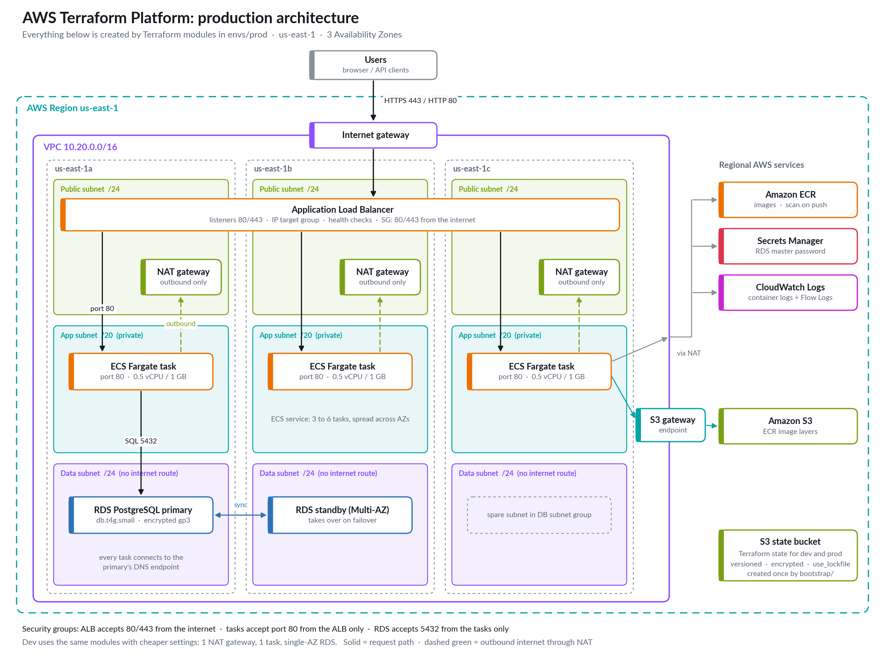

# Marck's DevOps Portfolio

## [AWS Terraform Platform](terraform-platform/)

Production-style AWS infrastructure built entirely with Terraform: a three-AZ VPC, an Application Load Balancer, an ECS Fargate service with auto scaling, PostgreSQL on RDS with Secrets Manager, and ECR, deployed to separate **dev** and **prod** environments with remote S3 state, native state locking, and TFLint, Checkov and gitleaks checks on every commit.

**Stack:** Terraform · AWS (VPC, ALB, ECS Fargate, RDS PostgreSQL, ECR, S3, CloudWatch, Secrets Manager) · pre-commit · TFLint · Checkov

See the [project README](terraform-platform/README.md) for the architecture, design decisions, setup steps and lessons learned.

## [Orders API with AWS CI/CD](orders-api/)

A Python (FastAPI) orders service on PostgreSQL, deployed by an AWS-native pipeline: GitHub → CodePipeline → CodeBuild (lint, tests against a real PostgreSQL, Docker build, push to ECR) → rolling ECS deploy with automatic rollback. It runs on the Project 1 platform.

**Stack:** AWS CodePipeline · CodeBuild · CodeConnections · ECR · ECS Fargate · Python · FastAPI · PostgreSQL · Docker
