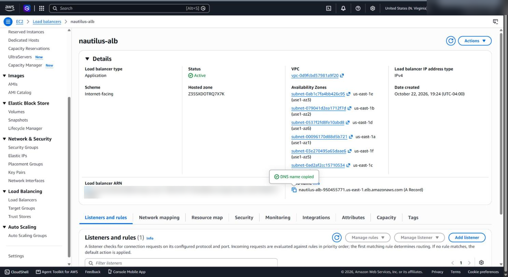
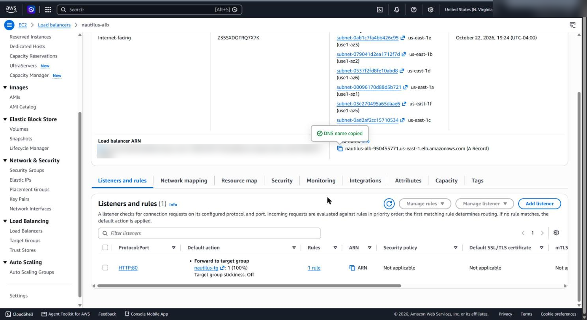
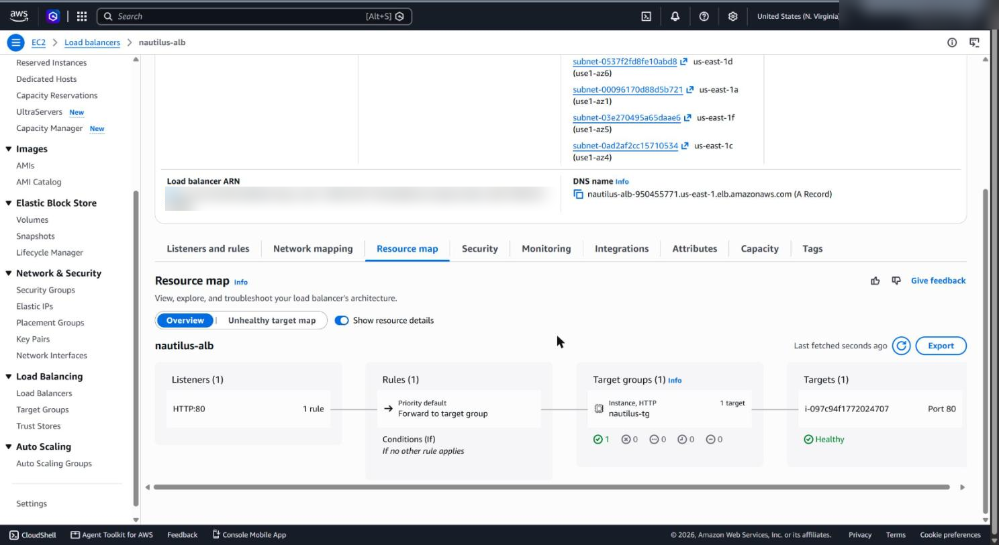
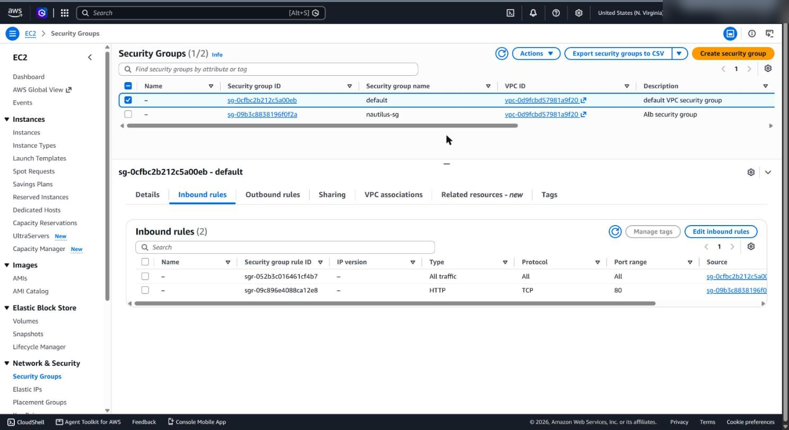
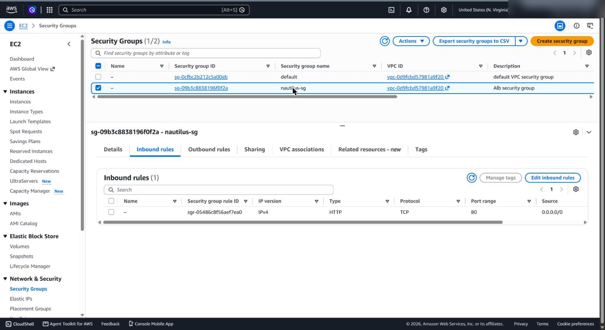

# Application Load Balancer in front of an EC2 web server

**Services:** EC2, Elastic Load Balancing (ALB), VPC security groups  ·  **Tools:** AWS Console  ·  **Completed:** 2026-10-22

## Goal

Put an internet-facing Application Load Balancer in front of an EC2 instance running Nginx, so public HTTP traffic on port 80 reaches the web server through the ALB, while the instance only accepts web traffic from the load balancer.

## Architecture

```
  Internet ──HTTP:80──► ALB (nautilus-alb)           ──HTTP:80──►  EC2 (nautilus-ec2, Nginx)
                        SG nautilus-sg:                             default SG:
                        allow 80 from 0.0.0.0/0                     allow 80 from nautilus-sg only
                        Listener HTTP:80 → target group nautilus-tg (instance targets, health check /)
```

| Resource | Name | Key settings |
| --- | --- | --- |
| Security group | `nautilus-sg` | Inbound HTTP 80 from `0.0.0.0/0`, attached to the ALB |
| Target group | `nautilus-tg` | Target type Instances, HTTP:80, health check path `/` |
| Load balancer | `nautilus-alb` | Internet-facing, IPv4, multiple AZs, listener HTTP:80 → `nautilus-tg` |
| Instance SG | `default` | Added inbound HTTP 80 with source `nautilus-sg` |

## Solution (Console)

### 1. Security group for the ALB
**EC2 → Security Groups → Create security group**: name `nautilus-sg`, same VPC as the instance, inbound rule **HTTP 80 from `0.0.0.0/0`**.

### 2. Target group
**EC2 → Target groups → Create target group**: target type **Instances**, name `nautilus-tg`, HTTP port 80, same VPC, health check HTTP `/`. Register `nautilus-ec2` on port 80.

### 3. Application Load Balancer
**EC2 → Load Balancers → Create → Application Load Balancer**
- Name `nautilus-alb`, **Internet-facing**, IPv4
- Same VPC, subnets in **at least two Availability Zones** (an ALB requires two or more)
- Security group: `nautilus-sg` only (remove `default`)
- Listener **HTTP:80 → forward to `nautilus-tg`**

### 4. Allow the ALB to reach the instance
The instance's **default** security group didn't allow HTTP from the ALB, so the target would fail health checks. **Edit inbound rules → add HTTP 80 with source = `nautilus-sg`** (the security group, not an IP range).

## Verification

- Target group `nautilus-tg` shows the instance as **Healthy** (the resource map shows the full chain: listener → rule → target group → healthy target).
- `curl http://<alb-dns-name>` returns the Nginx page.

```bash
aws elbv2 describe-target-health --target-group-arn <tg-arn> \
  --query "TargetHealthDescriptions[*].[Target.Id,TargetHealth.State]" --output table
curl -I http://<alb-dns-name>
```

## Troubleshooting

Common failure points with this setup:

| Symptom | Cause | Fix |
| --- | --- | --- |
| Can't create the ALB: needs subnets in two AZs | An ALB must span at least two Availability Zones | Select two or more subnets in different AZs |
| Target stays **Unhealthy** | Instance SG doesn't allow port 80 from the ALB | Add inbound HTTP 80 from the ALB's security group |
| Target **Unhealthy**, SG is correct | Nginx not running, or the health check path returns non-200 | Check Nginx on the instance; use `/` or a path that returns 200 |
| ALB DNS name times out | ALB SG doesn't allow port 80, or the ALB is still provisioning | Check `nautilus-sg` inbound; wait for state **Active** |
| `502 Bad Gateway` | ALB can reach the instance but the app isn't answering on port 80 | Confirm the target port matches the port Nginx listens on |

<!-- Add anything that went wrong during your own run here. -->

## What I learned

- **Security group chaining:** referencing the ALB's security group as the source (instead of `0.0.0.0/0`) means only the load balancer can reach the instance on port 80. The ALB is the only public entry point.
- **Health checks decide routing.** The ALB only sends traffic to targets that pass the health check, so an unhealthy target almost always means a network rule or the app itself.
- **The resource map is the fastest debugging view:** listener → rule → target group → target health on one screen.
- An ALB needs at least two AZs. That's what makes it highly available, and it's the first step toward adding an Auto Scaling group behind it.

## Screenshots

Account IDs and usernames are blurred.

**ALB active, internet-facing, across multiple Availability Zones**



**Listener: HTTP:80 forwards to nautilus-tg**



**Resource map: listener → rule → target group → healthy instance**



**Instance's default SG: HTTP 80 allowed only from the ALB's security group**



**ALB security group: HTTP 80 open to the internet**


