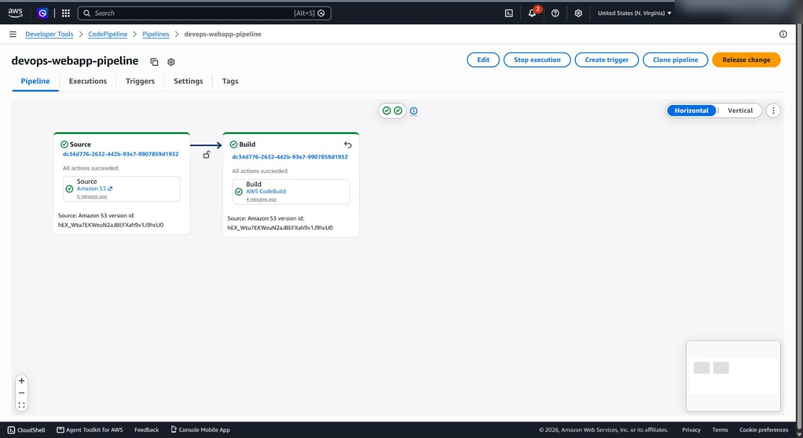
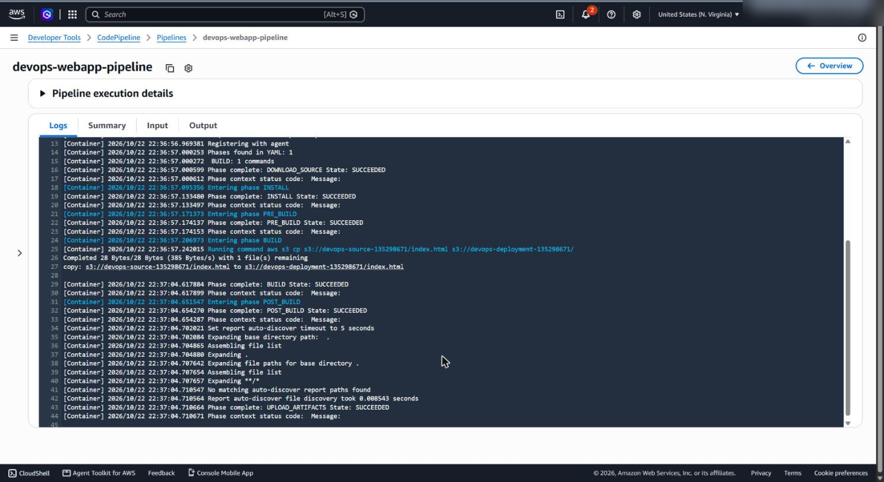
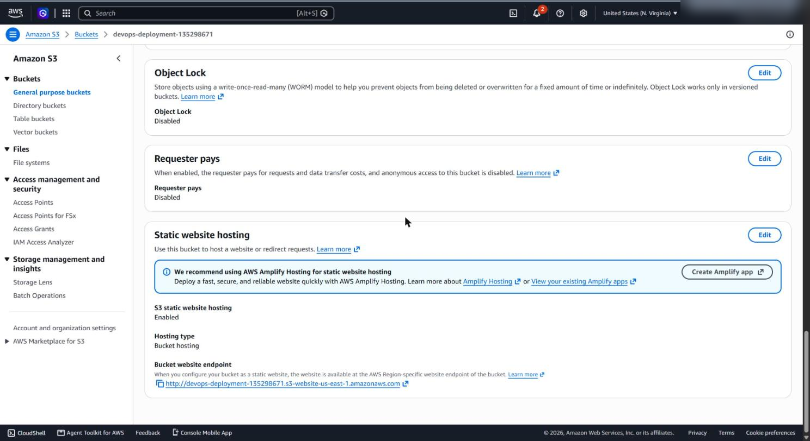
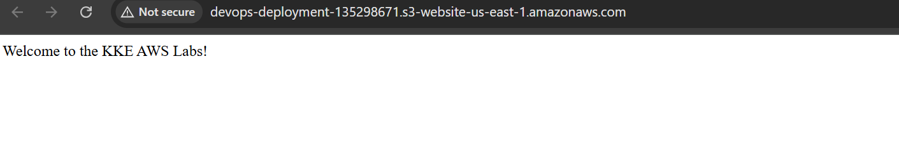

# CI/CD for a static website with AWS CodePipeline

**Services:** S3, CodePipeline, CodeBuild, IAM, EventBridge  ·  **Tools:** AWS Console  ·  **Completed:** 2026-10-22

## Goal

Automate deployment of a static website. Whenever `index.html` changes in a source S3 bucket, a pipeline picks up the change, runs a CodeBuild job, and publishes the file to a second S3 bucket that serves the site publicly.

## Architecture

```
  Source S3 bucket            CodePipeline                     Deployment S3 bucket
  (versioned)        ──►  Source ──► Build (CodeBuild)  ──►   (static website, public read)
  index.html change          │     aws s3 cp source → website        │
       │                     │                                       ▼
       └── EventBridge rule starts the pipeline           http://<bucket>.s3-website-us-east-1.amazonaws.com
```

There is no separate Deploy stage: the build step itself copies the file to the website bucket.

| Resource | Name |
| --- | --- |
| Source bucket | `<source-bucket>` (existing, holds a single `index.html`) |
| Deployment bucket | `<deployment-bucket>` |
| Pipeline | `webapp-pipeline` |
| CodeBuild project | `webapp-build-project` |

## Solution (Console)

The order matters: build the CodeBuild project and its permissions **before** the pipeline, so the pipeline's first run succeeds.

### 1. Prepare the source bucket
**S3 → `<source-bucket>` → Properties → Bucket Versioning → Enable.** CodePipeline only accepts a versioned bucket as an S3 source.

### 2. Create the website bucket
1. **S3 → Create bucket**: name `<deployment-bucket>`, region `us-east-1`.
2. Uncheck **Block all public access** and acknowledge the warning.
3. **Properties → Static website hosting → Edit**: enable, host a static website, index document `index.html`.
4. **Permissions → Bucket policy**: paste [`bucket-policy.json`](bucket-policy.json) (public `s3:GetObject` on the bucket's objects).

### 3. Create the CodeBuild project
**CodeBuild → Create build project**
- Name `webapp-build-project`, source **No source** (CodePipeline supplies it)
- Environment: managed image, Amazon Linux, image `aws/codebuild/amazonlinux2-x86_64-standard:4.0`, **Always use the latest image for this runtime version**, compute 2 vCPUs / 4 GiB memory, new service role
- Buildspec: **Insert build commands → Switch to editor**, using [`buildspec.yml`](buildspec.yml)

### 4. Give the CodeBuild role access to both buckets
**IAM → Roles → `codebuild-webapp-build-project-service-role` → Add permissions → Create inline policy**, using [`codebuild-s3-policy.json`](codebuild-s3-policy.json): `s3:GetObject` on the source bucket and `s3:PutObject` on the website bucket, nothing more.

### 5. Create the pipeline
**CodePipeline → Create pipeline → Build custom pipeline**
1. Name `webapp-pipeline`, new service role.
2. **Source:** Amazon S3, bucket `<source-bucket>`, object key `index.html`, change detection **Amazon EventBridge**.
3. **Build:** **Other build providers → AWS CodeBuild**, project `webapp-build-project`. (Not the "Commands" option; see Troubleshooting.)
4. **Deploy:** skip.
5. **Create pipeline**, which triggers the first run.

## Verification

- Both pipeline stages show **Succeeded**.
- `index.html` is in the deployment bucket:
  ```bash
  aws s3 ls s3://<deployment-bucket>/
  ```
- The site loads from the website endpoint:
  ```bash
  curl http://<deployment-bucket>.s3-website-us-east-1.amazonaws.com
  ```
- Upload a changed `index.html` to the source bucket: the pipeline starts on its own and the site shows the new version.

## Troubleshooting

My first attempt ran out of lab time after four separate failures, and the second attempt hit one more. Each one taught something, so here they are in the order I hit them.

| # | Error | Cause | Fix |
| --- | --- | --- | --- |
| 1 | `COMMAND_EXECUTION_ERROR: Error while executing command: version: 0.2. Reason: exit status 127` | In the pipeline wizard I picked the **Commands** build provider and pasted buildspec YAML into it. That box runs each line as a shell command, so the shell tried to run `version: 0.2`. | Use **Other build providers → AWS CodeBuild**. YAML belongs in the CodeBuild buildspec editor; the plain commands box takes commands only. |
| 2 | `not authorized to perform: codebuild:StartBuild ... because no identity-based policy allows the codebuild:StartBuild action` | After switching the stage to CodeBuild, the pipeline's role still had the permissions generated for "Commands", which don't include starting CodeBuild builds. | Grant the **pipeline role** `codebuild:StartBuild` and `codebuild:BatchGetBuilds` on the project ([`codepipeline-codebuild-policy.json`](codepipeline-codebuild-policy.json)). Selecting CodeBuild while creating the pipeline avoids this entirely. |
| 3 | `The user-provided path index.html does not exist.` | The source object is a bare `index.html`, not a `.zip`. CodePipeline hands S3 sources to CodeBuild as a zip archive, so a lone HTML file doesn't unpack as `index.html` in the build folder. | Copy straight from the source bucket: `aws s3 cp s3://<source-bucket>/index.html s3://<deployment-bucket>/`. (Or zip the site before uploading it as the source.) |
| 4 | `An error occurred (403) when calling the HeadObject operation: Forbidden` | The **CodeBuild role** had no permission to read the source bucket. | Inline policy on the CodeBuild role: `s3:GetObject` on the source bucket, `s3:PutObject` on the website bucket. |
| 5 | Deploy stage: `The input artifact .../BuildArtif/... does not exist ... NoSuchKey (404)` | On the second attempt the pipeline still had a Deploy (Amazon S3) stage. It expects an output artifact from the Build stage, but the buildspec only copies the file and declares no `artifacts` section, so there was nothing to deploy. | Delete the Deploy stage (the build step already publishes the site), then **Release change**. |

Other common failure points in this setup:

| Symptom | Fix |
| --- | --- |
| Source bucket rejected when creating the pipeline | Enable Bucket Versioning on it |
| Bucket policy won't save (`Access denied`) | Turn off Block Public Access on the website bucket first |
| Site returns 403 Forbidden | Add the public-read bucket policy |

## What I learned

- **Two roles, two jobs.** The pipeline role needs permission to *start* CodeBuild; the CodeBuild role needs permission to touch the *S3 buckets*. A 403 or AccessDenied error tells you which role by naming it (`assumed-role/<role-name>`).
- **Read the phase in the build log.** `DOWNLOAD_SOURCE` succeeded every time, which ruled out the source stage and pointed each error at the build commands or permissions.
- **CodePipeline passes artifacts as zip files.** A non-zip S3 source object doesn't unpack as-is, so either zip the source or read the object directly from the bucket.
- **Order resources by dependency.** Building the CodeBuild project and its IAM permissions before the pipeline avoids half the errors above.

## Screenshots

Account IDs and usernames are blurred.

**Pipeline: both stages succeeded**



**CodeBuild log: `index.html` copied to the website bucket**



**Website bucket: static website hosting enabled**



**Live site served from the S3 website endpoint**


