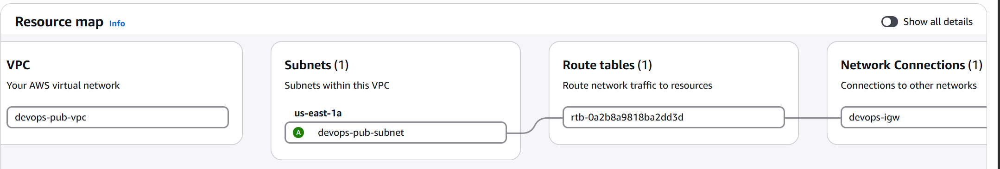
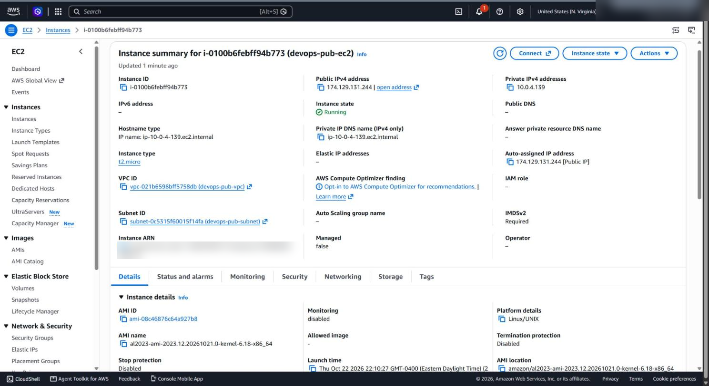
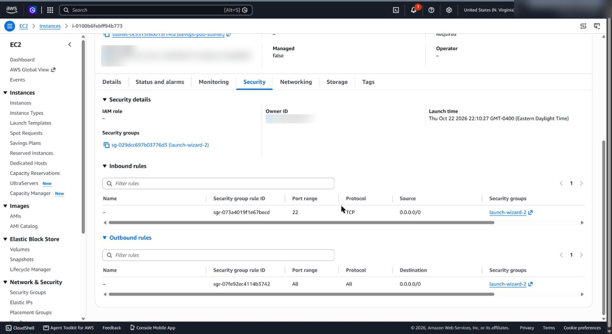
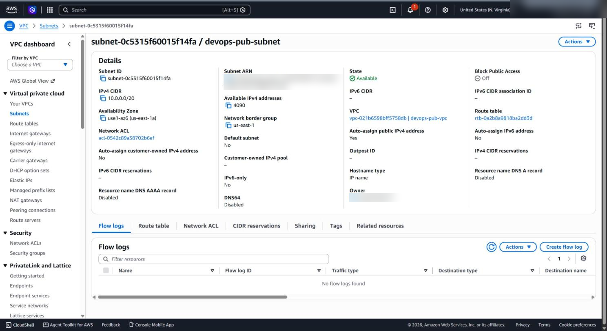
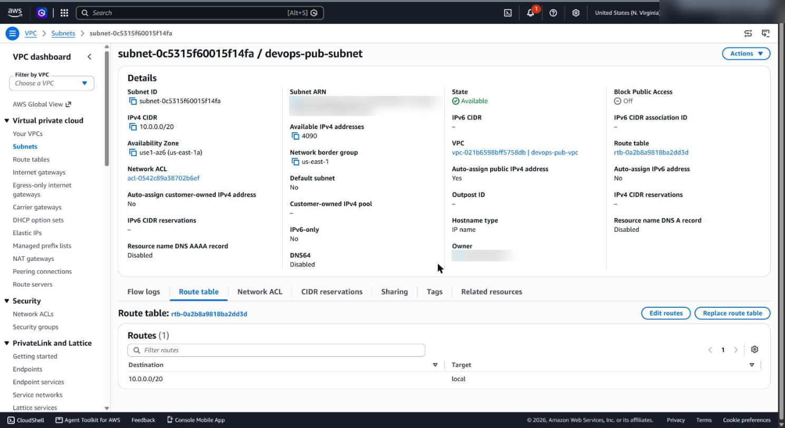

# Public VPC with an internet-reachable EC2 instance

**Services:** VPC, Subnets, Internet Gateway, Route tables, EC2, Security groups  ·  **Tools:** AWS Console  ·  **Completed:** 2026-10-22

## Goal

Build a public network from scratch: a new VPC with a public subnet that auto-assigns public IPs, and an EC2 instance in it that can be reached over SSH (port 22) from the internet.

## Architecture

```
  Internet
     │
  Internet Gateway (devops-igw) ── attached to ── VPC devops-pub-vpc (10.0.0.0/20)
     │
  Route table: 10.0.0.0/20 → local
               0.0.0.0/0   → devops-igw
     │
  Subnet devops-pub-subnet (us-east-1a, auto-assign public IPv4 = Yes)
     │
  EC2 devops-pub-ec2 (t2.micro, public IP)  ◄── SG: SSH 22 from 0.0.0.0/0
```

A subnet is "public" because of its **route to an Internet Gateway**, not because of its name or the public IPs on its instances.

## Solution (Console)

1. **VPC** → Your VPCs → Create VPC → **VPC only**, name `devops-pub-vpc`, IPv4 CIDR `10.0.0.0/20`.
2. **Subnet** → Create subnet in `devops-pub-vpc`, name `devops-pub-subnet`, AZ `us-east-1a`, CIDR `10.0.0.0/20`. Then **Actions → Edit subnet settings → Enable auto-assign public IPv4 address**.
3. **Internet Gateway** → Create `devops-igw` → **Actions → Attach to VPC → `devops-pub-vpc`**.
4. **Route table** → the route table used by the subnet → **Edit routes → Add route `0.0.0.0/0` → Internet Gateway → select `devops-igw` from the list → Save changes**.
5. **EC2** → Launch instance `devops-pub-ec2`, Amazon Linux 2023, `t2.micro`, in `devops-pub-vpc` / `devops-pub-subnet`, auto-assign public IP enabled, new security group allowing **SSH 22 from `0.0.0.0/0`**.

## Verification

- The VPC **resource map** shows subnet → route table → Internet Gateway.
- The instance is **Running** with an auto-assigned public IPv4 address.
- SSH works from outside the VPC:
  ```bash
  ssh -i <key>.pem ec2-user@<public-ip>
  ```

## Troubleshooting

| Problem | Cause | Fix |
| --- | --- | --- |
| Instance has a public IP, but the subnet's route table shows only `10.0.0.0/20 → local` | The Internet Gateway route was never saved. On the Edit routes page the target box held just the text `igw-`, so no gateway was actually selected, and the change wasn't saved. | Pick the gateway **from the dropdown** (typing `igw-` isn't enough), click **Save changes**, and confirm the route shows `0.0.0.0/0 → igw-…` with status **Active**. |
| Internet Gateway isn't in the target list | IGW created but not attached to the VPC | Internet gateways → Actions → **Attach to VPC** |
| Instance launched without a public IP | Subnet auto-assign was off at launch time | Enable it on the subnet *before* launching, or attach an Elastic IP |
| SSH times out | Missing IGW route, or SG doesn't allow port 22 | Check the route table first, then the security group |

Screenshot 5 below shows the route table **before the fix**: a public IP alone isn't enough.

## What I learned

- **What makes a subnet public:** a route table entry `0.0.0.0/0 → Internet Gateway`. Auto-assigned public IPs are useless without it. This is a classic interview question.
- **Every VPC needs three pieces for internet access:** an attached IGW, a route to it, and a public IP on the instance. The security group then controls which ports are allowed.
- **The VPC resource map** shows the subnet → route table → gateway chain on one screen, which is the quickest way to confirm a subnet is public.
- Opening SSH to `0.0.0.0/0` is fine in a lab; in production, restrict it to a known IP range or use Session Manager instead of open SSH.

## Screenshots

Account IDs and usernames are blurred.

**VPC resource map: subnet → route table → Internet Gateway**



**EC2 instance running with an auto-assigned public IP in devops-pub-subnet**



**Security group: SSH 22 open to the internet**



**Subnet: auto-assign public IPv4 address = Yes**



**Before the fix: route table with only the local route (no internet access)**


