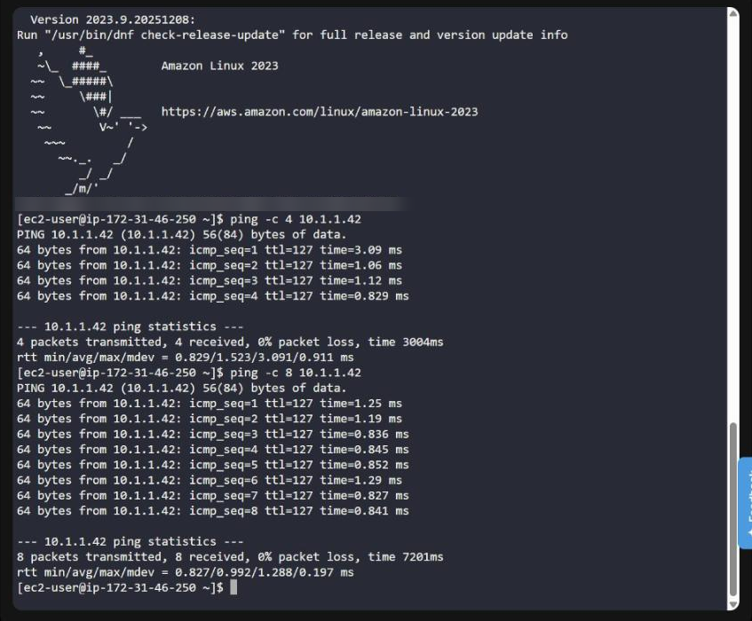
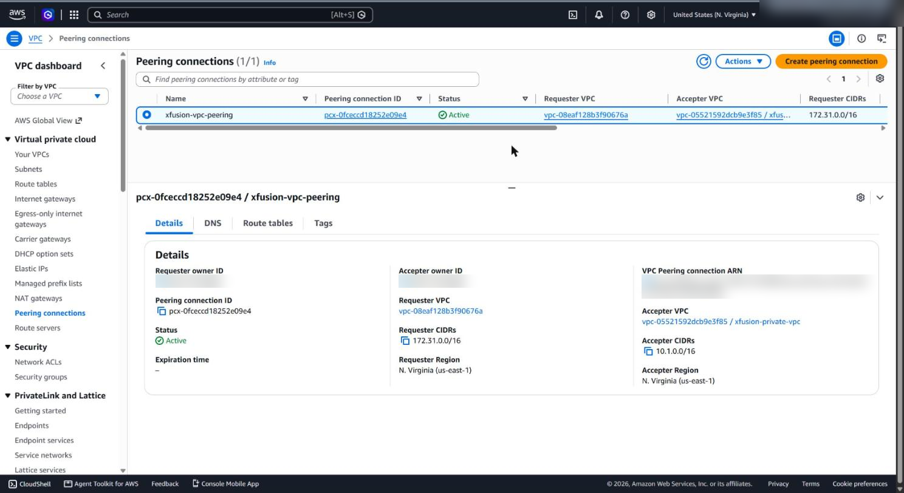
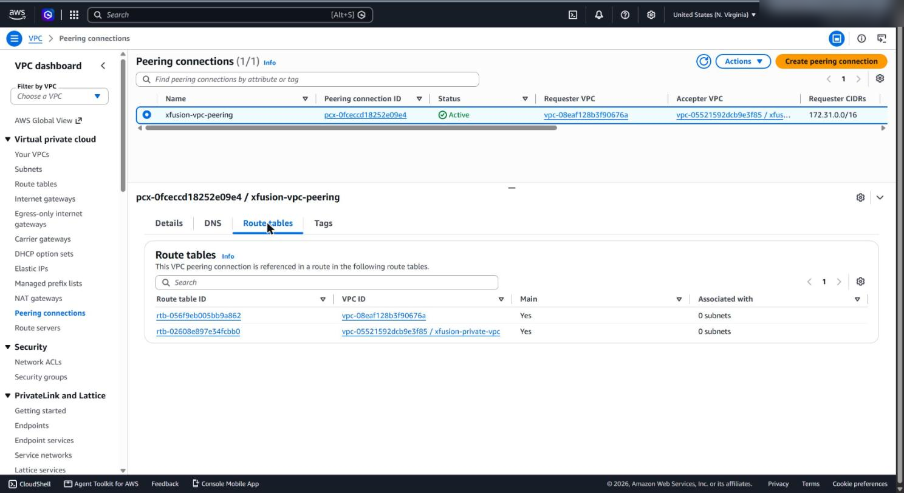
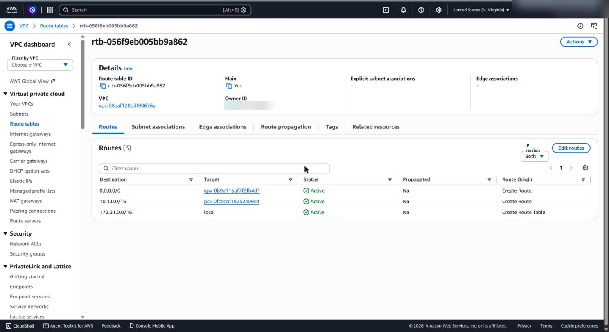
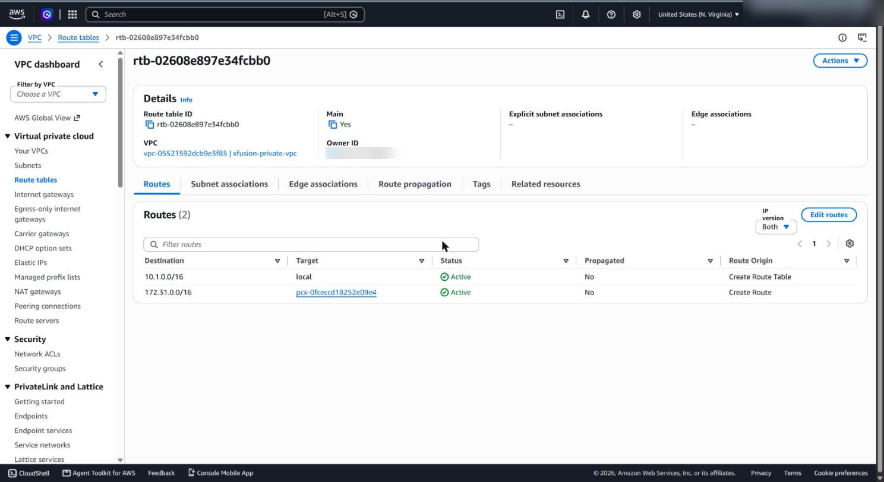
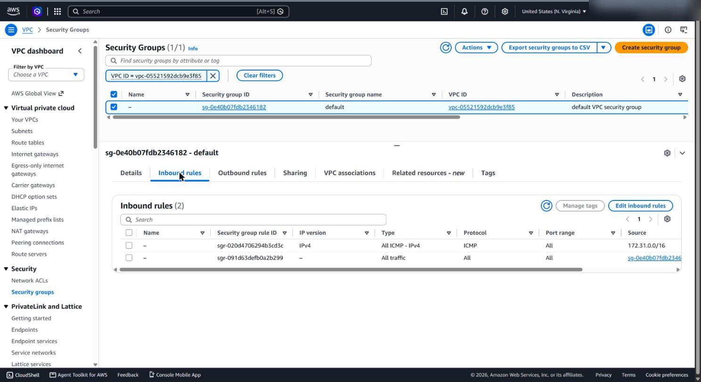

# VPC peering: reaching a private instance from a public VPC

**Services:** VPC peering, Route tables, EC2, Security groups, EC2 Instance Connect  ·  **Tools:** AWS Console, SSH  ·  **Completed:** 2026-10-22

## Goal

Connect the default (public) VPC to a separate private VPC with VPC peering, so an EC2 instance in the public VPC can reach an EC2 instance in the private subnet, which has no internet access of its own. Prove it by SSH-ing into the public instance and pinging the private one.

## Architecture

```
  aws-client ──SSH──► Public EC2 (default VPC 172.31.0.0/16)
                          │
                          │  ping 10.1.1.42
                          ▼
              VPC peering connection (pcx-…)  "xfusion-vpc-peering"
                          │
                          ▼
                      Private EC2 (private VPC 10.1.0.0/16, subnet 10.1.1.0/24)
                      SG: All ICMP-IPv4 from 172.31.0.0/16

  Default VPC route table:  10.1.0.0/16  → pcx-…   (plus 0.0.0.0/0 → igw, local)
  Private VPC route table:  172.31.0.0/16 → pcx-…  (plus local)
```

| Resource | Name |
| --- | --- |
| Public instance | `xfusion-public-ec2` (default VPC) |
| Private VPC / subnet | `xfusion-private-vpc` `10.1.0.0/16` / `xfusion-private-subnet` `10.1.1.0/24` |
| Private instance | `xfusion-private-ec2` |
| Peering connection | `xfusion-vpc-peering` |

## Solution (Console)

1. **Create the peering connection**: VPC → Peering connections → Create. Name `xfusion-vpc-peering`, requester = default VPC, accepter = `xfusion-private-vpc` (same account and Region).
2. **Accept it**: Actions → Accept request. Status changes from *Pending acceptance* to **Active**.
3. **Add a route on both sides**, pointing at the peering connection:
   - Default VPC route table: `10.1.0.0/16 → pcx-…`
   - Private VPC route table: `172.31.0.0/16 → pcx-…`
4. **Allow ICMP into the private instance**: its security group gets an inbound rule **All ICMP - IPv4** from `172.31.0.0/16`.
5. **Let the aws-client SSH into the public instance**: copy `/root/.ssh/id_rsa.pub` from the aws-client, open the public instance with **EC2 Instance Connect**, and append the key to `~/.ssh/authorized_keys` for `ec2-user`.
6. **Test**: SSH from the aws-client to the public instance, then ping the private instance's private IP.

## Verification

```bash
ssh ec2-user@<public-instance-ip>
ping -c 4 10.1.1.42
# 4 packets transmitted, 4 received, 0% packet loss
```

The ping goes from `172.31.x.x` to `10.1.1.42` with 0% loss, so traffic crosses the peering connection in both directions.

## Troubleshooting

| Symptom | Cause | Fix |
| --- | --- | --- |
| Peering stuck in *Pending acceptance* | Accepter side hasn't accepted | Actions → Accept request |
| Ping gets no reply | Route missing on **one** side, so replies can't return | Add the route in *both* VPCs' route tables, using the table each subnet actually uses |
| Ping still fails with routes in place | Private instance SG blocks ICMP | Inbound **All ICMP - IPv4** from the other VPC's CIDR |
| Route doesn't appear in the console right after saving | Console view was stale | Refresh the route table page before assuming it failed |
| `Permission denied (publickey)` | Key not added to `ec2-user`'s `authorized_keys` | Append the full `id_rsa.pub` line as `ec2-user` |
| Can't create the peering | The two VPCs' CIDRs overlap | Peered VPCs need non-overlapping CIDRs |

<!-- Add anything that went wrong during your own run here. -->

## What I learned

- **Routes are needed on both sides.** Peering creates a path, but each VPC only sends traffic to the other's CIDR if its route table says so; otherwise the replies have nowhere to go.
- **Security groups are stateful.** Only the private instance needs an inbound ICMP rule; the replies are allowed back automatically.
- **ICMP has no ports.** An SSH rule (TCP 22) doesn't permit ping; it needs its own ICMP rule.
- **Peering isn't transitive.** If A ↔ B and B ↔ C, A still can't reach C through B. Large networks use a Transit Gateway instead.
- The private instance stays private: it's reachable only from inside the peered network, never from the internet.

## Screenshots

Account IDs, usernames and source IPs are blurred.

**Ping from the public instance to the private instance across the peering: 0% packet loss**



**Peering connection: Active, 172.31.0.0/16 ↔ 10.1.0.0/16**



**Route tables that reference the peering, one in each VPC**



**Default VPC route table: 10.1.0.0/16 → pcx**



**Private VPC route table: 172.31.0.0/16 → pcx**



**Private instance security group: All ICMP - IPv4 from the default VPC CIDR**


